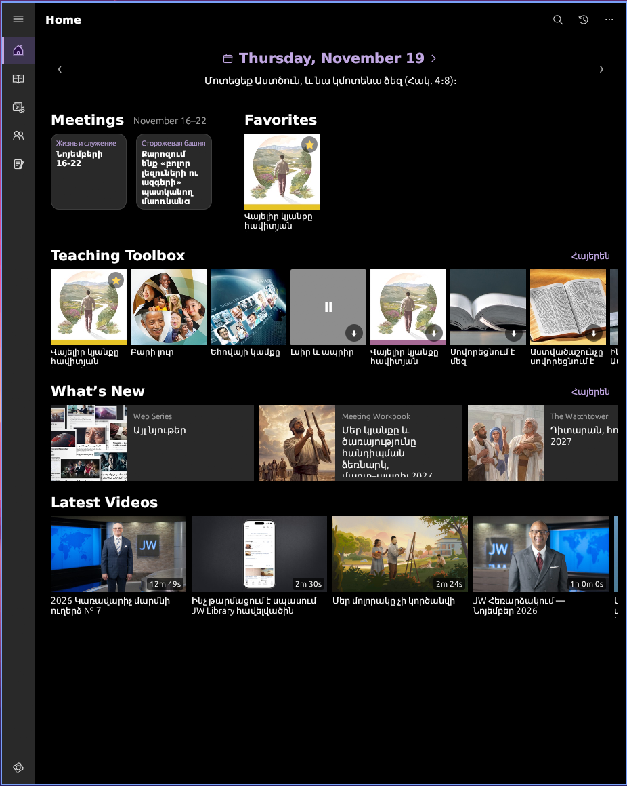
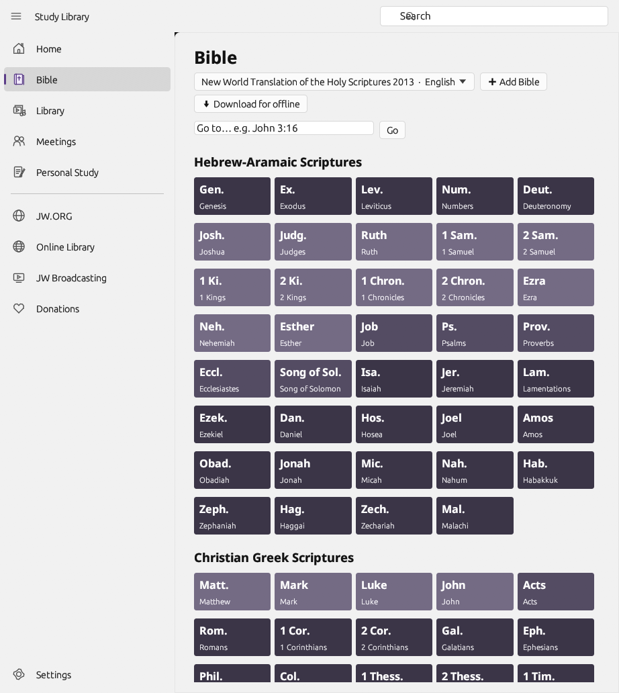

<div align="center">

# 📖 Study Library for Linux
## ⚙️ Still in progress
**A fast, native Bible and publication reader that runs on any Linux distribution.**


&nbsp;&nbsp;

</div>

---

## ✨ Features

- 🏠 **Home** – daily text, favorites, this week's meetings, continue reading, Teaching Toolbox and What's New
- 📚 **Bible** – all 66 books, chapter grid, "Go to… John 3:16" quick jump, offline download
- 🗂️ **Library** – browse and download publications (EPUB/PDF) by type and language
- 🎬 **Media** – video and audio playback built in (no external player needed)
- 👥 **Meetings** – weekly meeting material at a glance
- 📝 **Personal Study** – highlights (6 colors), notes, tags, bookmarks, playlists
- 🔁 **Backup / restore** – imports `.jwlibrary` backups made on Windows, Android or iPhone
- 🔎 **Search** across the library
- 🌍 **Many languages**, adjustable text size, light/dark theme
- 🪶 **Single small binary** – no Electron, no browser engine, no runtime to install

## 🖥️ Where does it run?

| | Supported |
|---|---|
| **OS** | Any Linux distribution – Ubuntu, Debian, Fedora, Arch, openSUSE, Mint, Manjaro, Pop!\_OS, Omarchy, … |
| **CPU** | x86\_64 (Intel/AMD) and arm64 / aarch64 |
| **Display** | Wayland **and** X11 |
| **glibc** | 2.17 or newer (anything from 2012 onward) |
| **Needs** | OpenGL (Mesa), PulseAudio or PipeWire for sound, an internet connection for downloads |

The universal installer is a single file, so the same download works everywhere.

---

## 🚀 Install (recommended): universal installer

1. **Get the installer** – `StudyLibrary-Installer.run` from the [Releases page](../../releases/latest), or build it yourself (see below).

2. **Open a terminal** in the folder that contains it and run:

   ```bash
   # for your user only (no password needed)
   sh StudyLibrary-Installer.run

   # or for everyone on the computer
   sudo sh StudyLibrary-Installer.run
   ```

3. **Launch** *Study Library* from your applications menu, or run:

   ```bash
   study-library
   ```

   > If `study-library` is "command not found" after a user install, add `~/.local/bin` to your `PATH`.

### Where things go

| | User install | `sudo` install |
|---|---|---|
| Program | `~/.local/share/study-library-app/` | `/opt/study-library/` |
| Command | `~/.local/bin/study-library` | `/usr/local/bin/study-library` |
| Menu entry | `~/.local/share/applications/` | `/usr/share/applications/` |
| Your data (notes, highlights, downloads) | `~/.local/share/study-library` | same |

### Uninstall

```bash
sh ~/.local/share/study-library-app/installer.run --uninstall
# (system-wide install)
sudo sh /opt/study-library/installer.run --uninstall
```

Your notes and downloads in `~/.local/share/study-library` are kept. Delete that folder too if you want a full clean-up.

### Moving from the Windows / Android / iPhone app

1. In the original app, create a backup (a `.jwlibrary` file).
2. In Study Library open **Personal Study → Backup**, enter the file's location and press **Restore / import**.

---

## 🛠️ Build from source (step by step)

### 1. Install the prerequisites

You need **git**, **Rust**, and **Zig** (Zig acts as the C/C++ compiler and linker, so you don't need `gcc`).

<details open>
<summary><b>Step 1.1 – Rust toolchain</b> (any distribution)</summary>

```bash
curl --proto '=https' --tlsv1.2 -sSf https://sh.rustup.rs | sh
source "$HOME/.cargo/env"
rustc --version
```
</details>

<details open>
<summary><b>Step 1.2 – Zig and cargo-zigbuild</b></summary>

Install Zig from your package manager or from <https://ziglang.org/download/> and make sure `zig` is on your `PATH` (or in `~/.cargo/bin`):

```bash
# Arch / Omarchy        sudo pacman -S zig
# Fedora                sudo dnf install zig
# Ubuntu / Debian       sudo snap install zig --classic --beta     (or download the tarball)
# any distro, via pip   pip install ziglang && ln -s "$(python3 -c 'import ziglang,os;print(os.path.dirname(ziglang.__file__))')/zig" ~/.cargo/bin/zig

cargo install cargo-zigbuild
zig version
```
</details>

<details>
<summary><b>Step 1.3 – Rust targets for the universal build</b> (only needed to build the installer)</summary>

```bash
rustup target add x86_64-unknown-linux-gnu aarch64-unknown-linux-gnu
```
</details>

### 2. Get the code

```bash
git clone https://github.com/TumanyanH/jwlb-linux.git
cd jwlb-linux/app
```

### 3a. Quick build and run (your own machine only)

```bash
cargo build --release
./target/release/study-library
```

The `.cargo/config.toml` in this repo makes Cargo use Zig through `tools/zigcc`, so no system C compiler is required.

Useful flags:

```bash
./target/release/study-library --help
./target/release/study-library --open bible:BOOK:CHAPTER     # jump straight to a chapter
./target/release/study-library --update-catalog              # refresh the publication catalog
./target/release/study-library --screenshot out.png          # render a frame to a PNG
```

### 3b. Build the universal installer (x86_64 + arm64 in one file)

```bash
sh packaging/make-installer.sh
```

This compiles against **glibc 2.17** with `cargo-zigbuild` for both architectures, packs the binaries and icon into a self-extracting script and writes:

```
app/dist/StudyLibrary-Installer.run     ← the universal installer
app/dist/study-library-x86_64           ← plain x86_64 binary
```

Then install it as described [above](#-install-recommended-universal-installer).

> If the arm64 build fails, the script warns you and still produces an x86\_64-only installer.

---

## 🧩 Troubleshooting

| Problem | Fix |
|---|---|
| Window doesn't open / OpenGL error | Install Mesa: `mesa` (Arch), `libgl1-mesa-dri` (Debian/Ubuntu), `mesa-dri-drivers` (Fedora) |
| Videos play without sound | Install PulseAudio or PipeWire (with the Pulse compatibility layer) |
| `study-library: command not found` | Add `~/.local/bin` to your `PATH`, or start it from the applications menu |
| Build: `zig: command not found` | Put `zig` on your `PATH` or in `~/.cargo/bin` (step 1.2) |
| Downloads fail | The app needs internet access for the catalog, Bibles, publications and media |

## 🗺️ Project layout

```
app/
├── src/            Rust source (UI, Bible reader, EPUB, catalog, media, backup import…)
├── data/           Language table
├── packaging/      Universal installer (make-installer.sh, installer-header.sh)
├── tools/          Zig-based C/C++ compiler wrappers
├── MECHANICS.md    Documented behaviors the app follows
└── mechanics.json  Machine-readable behavior sheet
```

**Tech:** Rust · [egui / eframe](https://github.com/emilk/egui) · SQLite (bundled) · OpenH264 · Symphonia

## ⚖️ Disclaimer

This is an independent, unofficial project. It is not affiliated with, endorsed by, or sponsored by the publishers of the original JW Library app or its content. Publications and media are downloaded from the publicly available online services at the user's request; all such content belongs to its respective owners.

## 📄 License

Source code released under the [MIT License](LICENSE) © Hakob Tumanyan.
